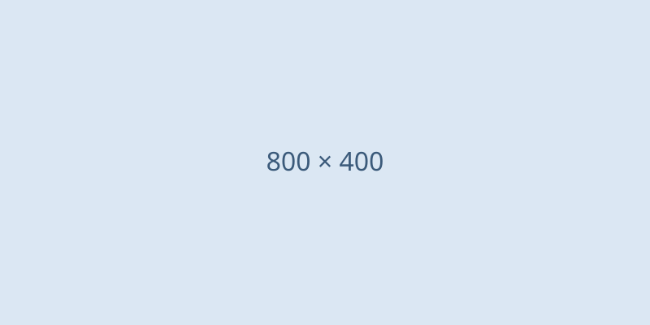

この記事はスタイル調整用の下書きです。`draft: true` なので、開発サーバーでのみ表示され、本番ビルドには含まれません。

本文の段落です。**太字**、*斜体*、~~打ち消し線~~、`インラインコード`、[リンク](https://docs.astro.build/) を含みます。日本語の文章が長く続いたときに、行間や文字サイズ、一行あたりの文字数が読みやすいかを確認するため、少し長めの文章を置いておきます。技術記事では説明が長くなりがちなので、段落の間隔も大事です。

二つ目の段落です。段落同士の余白がどのくらい空くかを確認します。

## 見出し2（章の区切り）

h2 は章の区切りとして使います。下線と上の余白で、前の章との区切りが分かるかを確認します。

### 見出し3（節）

h3 は節です。目次にも表示されます。

#### 見出し4（小見出し）

h4 は目次には表示されません。

### とても長い見出しが折り返されたときに、目次や本文でどのように表示されるかを確認するための見出し

長い見出しの表示確認用です。

## コードブロック

### ファイル名付き

```ts title="src/lib/posts.ts"
import { getCollection, type CollectionEntry } from 'astro:content';

export type Post = CollectionEntry<'blog'>;

/** 公開日の新しい順に記事を返す。下書きは開発サーバーでのみ含める */
export async function getPosts(): Promise<Post[]> {
  const posts = await getCollection('blog', ({ data }) => import.meta.env.DEV || !data.draft);
  return posts.sort((a, b) => b.data.pubDate.valueOf() - a.data.pubDate.valueOf());
}
```

### ファイル名なし

```js
const message = 'ファイル名を付けないコードブロック';
console.log(message);
```

### ターミナル

```bash
pnpm install
pnpm astro dev --background
```

### 行のハイライトと差分

```astro title="src/layouts/PostLayout.astro" {2} ins={3} del={4}
---
import BaseLayout from './BaseLayout.astro';
import TableOfContents from '../components/TableOfContents.astro';
import OldComponent from '../components/OldComponent.astro';
---
```

```diff
- const width = '48rem';
+ const width = '72rem';
```

### 長い行（横スクロール）

```json title="package.json"
{
  "description": "とても長い行が横スクロールになるか、それとも折り返されるかを確認するための行です。とても長い行が横スクロールになるか、それとも折り返されるかを確認するための行です。"
}
```

### 言語指定なし

```
プレーンテキストのコードブロック
言語を指定しない場合の表示
```

## リスト

- 箇条書き1
- 箇条書き2
  - ネストした箇条書き
  - ネストした箇条書き
    - さらにネスト
- 箇条書き3

1. 番号付きリスト1
2. 番号付きリスト2
   1. ネストした番号付きリスト
3. 番号付きリスト3

- [x] 完了したタスク
- [ ] 未完了のタスク

## 引用

> 引用文です。他の記事や公式ドキュメントからの引用に使います。
>
> 引用の中の二つ目の段落です。

## 表

| 項目 | 説明 | 備考 |
|---|---|---|
| `title` | 記事タイトル | 必須 |
| `description` | 概要文。記事一覧や OGP に使われる | 必須 |
| `tags` | タグの配列 | |

## 画像



## 水平線

水平線の上の段落です。

---

水平線の下の段落です。

## 脚注

脚注付きの文章です[^1]。

[^1]: 脚注の内容です。

## おわりに

最後の章です。目次の現在地のハイライトが、ページ末尾までスクロールしたときに正しく切り替わるかを確認します。
